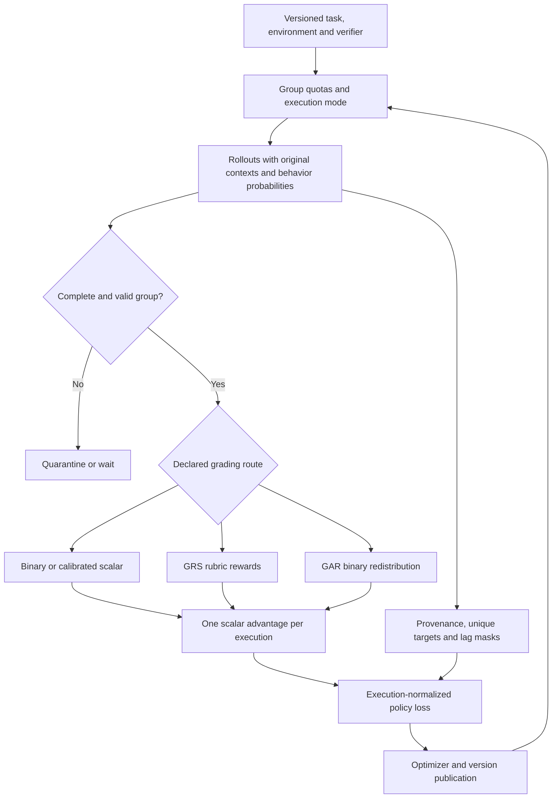

# FusionRL design and compatibility decisions

## Design decision

FusionRL separates five responsibilities: task/environment definition, rollout execution, trustworthy assessment, immutable training-target selection, and policy optimization. A mechanism can be combined with another only if both agree on the meaning of a group, the policy that produced an action, the target token's original context, and its normalization weight.

The shared learner is execution-based. A task can produce many requests, branches, summaries and tool interactions; those are not automatically independent reward samples. The independent sample is an original rollout execution. A complete group contains N executions with the same task, prompt, effort, harness, rubric/configuration revision and reward scale. A batch contains B such groups with a common N.

## How the six sources enter the design

The following is a selection map, not a claim that the combined system inherits the sources' performance. Exact source locators are in [SOURCES.md](../SOURCES.md).

| Source | Retained concept | FusionRL boundary or modification |
|---|---|---|
| DeepSeek V4.1 report, §5 | Task/environment/verifier contracts; effort-conditioned cost; stale-token handling; staged post-training | Effort remains part of group identity. Generic caches are invalidated at weight changes. OPD is a separate phase. Architecture-specific optimizations are excluded. |
| MiMo V2.6 report, §§4.3, 5, 6 | Alternative GRS/GAR signals; group conditioning; explicit token provenance and mixed-task scheduling | Grades become scalar execution advantages. Its distinct token rejection and prompt-token normalization are replaced by the selected common objective. |
| MiMo RL dataset | Public task envelopes, verifier metadata and environment references | Five actual schemas are normalized without exposing private verifier assets as model instructions. |
| XiaomiMiMo/verl | Concrete actor, rollout, reward, data and training interfaces | A pinned, narrow adapter preserves actual behavior probabilities and enforces one-row execution semantics. |
| Seer, §§3.2–3.4 | Synchronous generation chunks and group-based length estimates | A portable heuristic makes placement decisions. A chunk cannot cross a policy change in strict mode. Production shared caches and speculative decoding are not reproduced. |
| QwenGyre, §§4–5, Appendix B | Execution identity, exact causal targets, publication boundaries and execution-level loss | The loss is the common optimizer. Path selection becomes deterministic; groups use fixed dispatch-order quotas; invalid assessments are quarantined. |

## Compatibility ledger

| Potential combination | Decision | Reason and implemented rule |
|---|---|---|
| GAR with GRS rewards in the same group | Reject | GAR's redistribution uses binary outcome advantages. GRS is a separate branch. |
| GAR with additive effort or relative-length cost | Reject | Continuous cost shaping would change the premise of binary redistribution. Concision can instead inform GAR's quality factors. |
| GRS with an effort cost | Allow with distinct rubric purpose | Correctness/quality and resource cost are separate scalar channels. Rubrics must not count the same length preference twice. |
| DeepSeek effort cost plus MiMo relative-length cost | Reject in a profile | Two uncalibrated controllers for one resource create ambiguous pressure. Choose one. |
| Continuous general/visual/music grades with GAR | Reject | Calibrate externally into [0,1] and use the explicitly named `scalar` route, or supply an actual binary gate plus GRS scores. No automatic threshold is invented. |
| Cross-effort or cross-harness relative ranking | Reject through group key | Different conditionings define different comparisons. A task mixture is constructed across groups. |
| Seer chunks with strict sync | Allow | Freeze policy across every chunk and wait for complete original groups before updating. |
| Seer-style placement inside async execution | Conditional | Each individual generation request remains pinned; later requests may use published versions only if actual per-token provenance is retained. This loses a strict on-policy interpretation. |
| DeepSeek completion-triggered dispatch plus QwenGyre boundary-dispatch accounting | Do not combine | They are different queue policies. FusionRL chooses boundary dispatch and records actual lag. |
| Readiness-based data selection plus length-balancing claim | Modify | Preassigned domain quotas and dispatch-order membership avoid fast-completion substitution, at a throughput cost. |
| QwenGyre execution loss plus another PPO/GSPO/rollout-IS objective | Reject | A second correction changes the optimized estimator. The existing token correction and execution mask are sufficient for the chosen design. |
| MiMo token-segment advantage edits plus scalar execution clipping | Exclude | Different token signs would no longer share an unambiguous execution-level clipping decision. Behavioral problems can affect the scalar verified grade or GAR ranking. |
| Original target tokens repeated along several paths | Deduplicate | Identity is sampling-event plus offset, scoped to an execution. Text equality alone is not identity. |
| Tool or harness text marked as assistant | Mask | Provenance controls trainability, not the rendered role label. |
| Invalid infrastructure outcome as reward zero | Quarantine | No policy outcome was validly evaluated. Recreate the entire group in its reserved slot. |
| Old KV after a generic model weight update | Invalidate | Same text does not imply same hidden states. Use original context with a fresh prefill under the new weights. |
| Full-vocabulary OPD between arbitrary tokenizers | Reject | Vocabulary size equality does not establish token-ID or normalization equivalence. |
| MoE router freezing plus routing replay | Backend-specific | Freezing does not guarantee identical routing after other parameters change. Dense demo uses neither; a real MoE path must implement and validate both declared capabilities. |

## Why the execution is the unit of weight

An agent may split one task into several branches. If every branch is counted as an independent rollout, a policy can increase its gradient weight merely by using more branches. Conversely, averaging every token globally gives more aggregate weight to executions that generate longer transcripts. FusionRL uses one reward comparison per original execution and a token average within that execution.

Shared target tokens are assigned to one admitted path before the objective is evaluated. The path cap changes which tokens are admitted, so it is a deliberate biased selection rule. Once the admitted set is fixed, placing a shared target on a different selected path cannot change that execution's ratio, clipping decision or loss. An execution with no targets has zero loss while retaining its original slot in B*N. It is not removed from its group's reward baseline.

The low-level learner checks common group size and complete execution cardinality even for manually constructed admitted records. This prevents an external adapter from silently redefining the denominator. A new design with different N per task would need explicit group weights and corresponding distributed reductions.

## Scheduling and quality are separate

`strict_sync` is the default reference: one frozen rollout policy, one complete batch, one update and one publication. `bounded_async` permits older groups or tokens, uses the same optimizer, and masks targets whose actual generating policy exceeds the configured lag cap. The cap is an admission guarantee expressed in model versions; it is not a statement about reward quality, total variation distance, or unbiased learning.

A complete group can be available before another group, but completion speed does not decide membership of an update. Fixed per-domain quotas prevent domain starvation from turning into hidden sampling policy. Keeping an older unfinished member may reintroduce straggler wait; this is the explicit cost of the conservative reference. Elastic placement and chunk ordering can improve utilization while that membership remains fixed.

The controller's publication counter must map to an installed checkpoint digest in a real deployment. Its pure-Python `publish()` is a decision, not a CUDA transfer. `ElasticState` similarly checks outstanding executions and stable training supply; it does not construct process groups or shard weights. Backend acknowledgments and a topology-specific migration mechanism are separate integrations.

## Probability support and original context

The numerator scores the generated token using the current model and the original recorded context. The denominator is the probability that actually sampled that token. Recomputing an older model in a different engine does not recover that denominator. A sampler with top-p truncation, temperature, logit penalties, a restricted vocabulary or a speculative draft has a probability law that must be represented accurately.

Portable profiles and the included verl adapter require temperature one and full support. This makes the recorded sampling probability compatible with the model log probability being scored. The data structures are general enough to retain exact probabilities from another sampler, but a correct probability-space contract and support analysis are required before exposing such a backend.

Compaction and subagents create new request contexts. Earlier tokens continue to use their old contexts. A masked stale token can remain in a newer token's original prefix; masking removes its target loss, not its historical causal role. Model-generated summaries can be targets when provenance is recorded; injected summaries cannot become policy targets merely because they resemble assistant text.

## Stages and model architecture

SFT is optional and initializes a policy on valid supervised data. RL then samples its own actions. OPD, if selected, starts after a publication boundary and cancellation of retained RL groups; it samples new student prefixes and scores them with a frozen teacher contract. The implementation chooses full-vocabulary reverse KL explicitly. This choice is not an assertion that an unpublished source implementation uses exactly the same divergence or gradient estimator.

Teacher architecture may differ while tokenizer mappings and conditioning inputs remain identical. A teacher with a different vocabulary requires a different distillation interface. The demonstration uses a disclosed synthetic oracle only. Private teacher pools, rubric synthesizers and graders are not reconstructed from missing weights.

CED, CSA2, Engram, attention layouts, FP4 KV formats, model-specific Muon/Sinkhorn updates and million-token memory systems are architectural commitments. Copying those labels into a generic RL config would not create compatible operators. FusionRL therefore operates on a supplied causal policy and reserves such features for an architecture-specific backend.

## Evaluation and rollout of a real deployment

Validate actual rollout-versus-training log probabilities before a costly run. Start with the supported single-row path and a tiny task set, then extend one backend responsibility at a time. The first new multimodal, MoE, multi-path or asynchronous transport must prove the same target and reduction invariants already covered by the portable tests. Track task success alongside tokens, turns, rubric quality, invalid groups, stale-target fraction, clipping fraction and domain quotas. A lower token count alone is not improvement.

Source benchmark scores and throughput figures are not FusionRL results. `examples/validation` demonstrates the algorithm and serialization using a synthetic 7,246-parameter causal policy. A real capability claim needs task-separated held-out evaluation, matched compute and repeated seeds after the hardware integration is operational.

